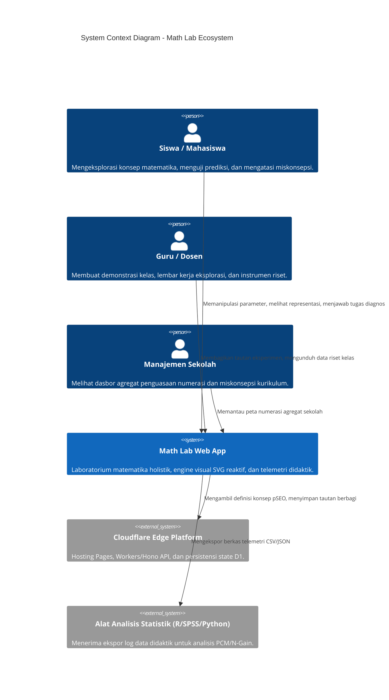
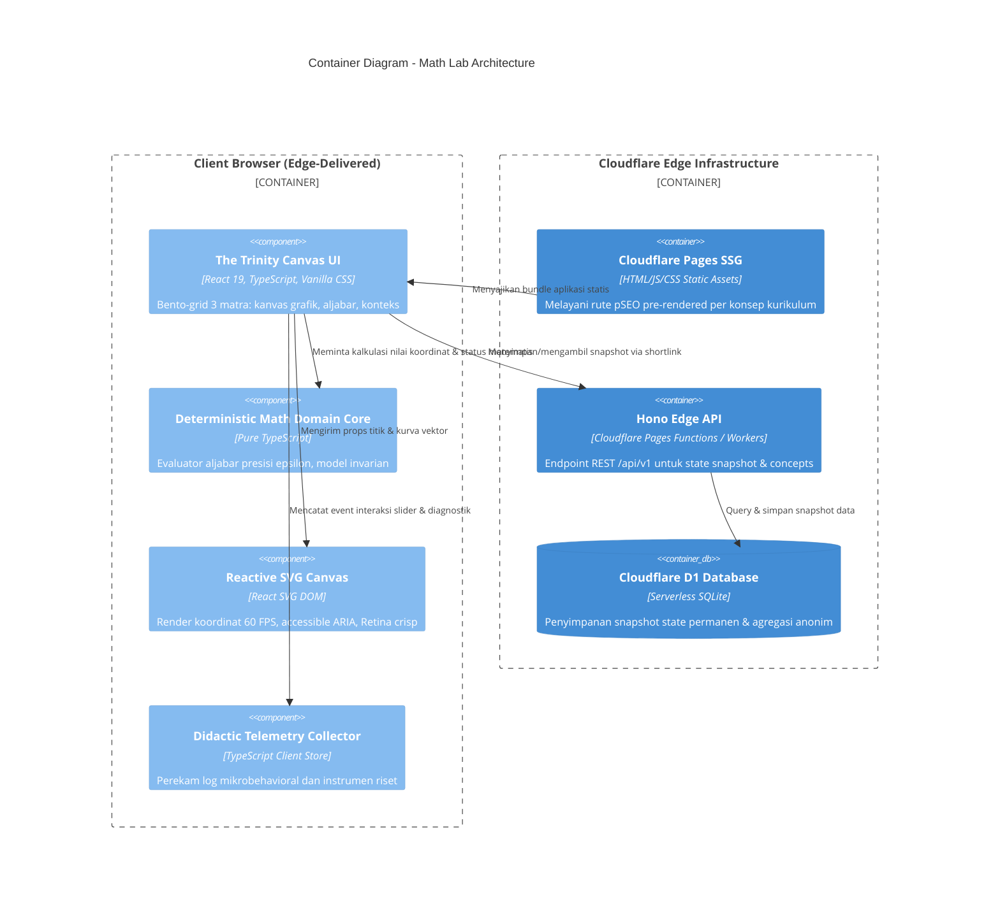

# MATH LAB: LIVING ARCHITECTURE & SYSTEM SPECIFICATIONS
## CONTEXT.md (Level 2 Canonical Architectural Living Document)

**Status:** Living Master Architecture & System Specifications  
**Modul:** `apps/mymathlab`  
**Governing Standard:** Invariant 5 (The 3-File Documentation Triad), C4 Architecture, Cognitive Product Architect, API and Interface Design  

---

## 1. Visi Sistemik & Tiga Pilar Pengguna

Math Lab dibangun untuk mengikis fragmentasi pemahaman matematika melalui pendekatan fundamental-holistik yang melayani 3 pilar ekosistem:

### 1.1 Pilar 1: Siswa & Guru (Pembelajaran Konseptual Interaktif)
- **Tujuan Kognitif:** Menggeser pemahaman instrumental (hafal rumus terisolasi) menjadi pemahaman relasional (*Skemp*).
- **Mekanisme Interaksi:** Kanvas eksplorasi manipulasi langsung (*direct manipulation*) dengan latensi respons sub-16ms.
- **Multirepresentasi Sinkron:** Memenuhi model translasi Lesh & register semiotik Duval (situasi riil, grafik visual, tabel diskret, dan simbol aljabar formal KaTeX).
- **Diagnostik Didaktik:** Deteksi miskonsepsi aktif sebelum siswa menyelesaikan latihan (umpan balik formatif langsung, bukan sekadar skor benar/salah).

### 1.2 Pilar 2: Pembelajar Mandiri, Mahasiswa, & Praktisi Sains Terapan (Advanced Exploration & Applied Modeling)
- **Eksplorasi Konseptual Lanjut:** Visualisasi interaktif untuk materi tingkat perguruan tinggi dan kalkulus lanjut (lingkaran satuan trigonometri analitis, kalkulus diferensial dan integral, serta aljabar linier matriks).
- **Pemodelan Fenomena Sains & Bisnis:** Pengujian skenario fenomena kuantitatif nyata (kinematika proyektil fisika, kurva penerimaan dan titik impas ekonomi, serta etnomatematika arsitektur).
- **Ekspor Data Terbuka (Open Data Integration):**
  - Ekspor data koordinat kurva dan ringkasan manipulasi dalam format CSV dan JSON terstandarisasi.
  - Kompatibel langsung untuk eksplorasi mandiri menggunakan Python, Jupyter, Google Sheets, atau perangkat lunak statistika.

### 1.3 Pilar 3: Guru, Sekolah, & Komunitas Belajar (Classroom Ergonomics & Educator Toolkit)
- **Ergonomi Presentasi Proyektor:** Antarmuka kontras tinggi ramah proyektor kelas XGA 2000-3000 ANSI lumen, garis kurva tebal 3.5px, teks arang pekat, dan mode sembunyikan formula untuk latihan tebak kurva.
- **Perangkat Pembelajaran Lengkap:** Penyediaan Lembar Kerja Peserta Didik (LKPD) digital interaktif serta lembar cetak fisik format A4 monokrom yang siap difotokopi untuk kelas dengan keterbatasan gawai.
- **Wawasan Formatif & Perkembangan Belajar:** Rekaman telemetri inkuiri anonim (*Zero PII*) untuk memetakan dinamika belajar kelas secara holistik: strategi eksplorasi siswa, kelancaran translasi antar-register, kemandirian merevisi prediksi, serta kesiapan siswa untuk melangkah ke tantangan pengayaan.


### 1.4 Kontinum Epistemologis: Konsep, Konteks, Teori, Pembelajaran, & Aplikasi Nyata
Math Lab merajut 5 dimensi pembelajaran matematika secara terpadu:
1. **Pemahaman Konsep (Conceptual Invariants):** Mempelajari esensi matematika di balik angka dan simbol, mengamati sifat invarian saat variabel digeser, serta memahami hukum simetri, kesetaraan, dan kontinuitas.
2. **Pemahaman Konteks (Realistic Context & Ethnomathematics):** Mengaitkan konsep dengan fenomena empiris nyata: lintasan gerak peluru di fisika, dinamika pertumbuhan di biologi, kurva penawaran-permintaan di ekonomi, serta geometri ragam hias candi dan batik.
3. **Pemahaman Teori & Simbolik (Formal Deductive Rigor):** Memberikan visualisasi deduktif atas teorema formal dan translasi register semiotik Duval (aljabar KaTeX, grafik SVG, tabel nilai, narasi kontekstual).
4. **Pembelajaran Inkuiri (Guided Inquiry & Scaffolding):** Wahana inkuiri terbimbing 5 langkah (*Observe -> Predict -> Manipulate -> Explain -> Apply*) yang memberikan umpan balik korektif sebelum terjadi penguncian miskonsepsi.
5. **Aplikasi Praktikal (Applied Decision Modeling):** Pemanfaatan matematika untuk menyelesaikan masalah konkret di lapangan, pemodelan data sederhana, dan pengambilan keputusan berbasis bukti.

### 1.5 Matriks Dukungan Penugasan Lintas Persona Pengguna
Math Lab secara fungsional melayani peran pengguna riil:

| Persona | Kebutuhan Utama di Math Lab | Luaran / Pengalaman yang Diperoleh |
| :--- | :--- | :--- |
| **Siswa (SMP/SMA)** | Eksplorasi mandiri dengan LKPD digital, menguji tebakan konsep, dan mengatasi kebingungan materi secara visual. | Pemahaman relasional yang kuat, kepercayaan diri meningkat, dan hilangnya ketakutan terhadap matematika. |
| **Mahasiswa & Pembelajar Mandiri** | Memvisualisasikan konsep abstrak kalkulus/aljabar linier dan menguji simulasi pemodelan terapan. | Pemahaman intuitif atas teori matematika tinggi dan data numerik siap olah. |
| **Guru & Instruktur** | Mendemonstrasikan kurva di proyektor kelas, membagikan tugas via tautan WhatsApp, dan mencetak LKPD fisik. | Kelas interaktif yang hidup, diskusi kelas yang aktif, dan penghematan waktu persiapan mengajar. |
| **Sekolah & Komunitas Pendidik** | Mengidentifikasi tren kesulitan belajar matematika di sekolah untuk bahan diskusi dan perbaikan pengajaran. | Wawasan berbasis bukti untuk penguatan literasi numerasi sekolah dan komunitas guru (MGMP). |


### 1.6 Taksonomi Kanonikal 7 Domain Matematika Semesta (Cakupan Teori & Praktikal)
Math Lab mencakup seluruh spektrum dasar matematika murni, didaktik sekolah, riset kampus, hingga sains keputusan praktikal:

```
                                    SEMESTA MATEMATIKA MATH LAB
  ┌───────────────┬───────────────┬───────────────┬───────────────┬───────────────┬───────────────┬───────────────┐
  ▼               ▼               ▼               ▼               ▼               ▼               ▼
[DOMAIN 1]      [DOMAIN 2]      [DOMAIN 3]      [DOMAIN 4]      [DOMAIN 5]      [DOMAIN 6]      [DOMAIN 7]
BILANGAN &      ALJABAR &       GEOMETRI,       KALKULUS &      STATISTIKA,     MATEMATIKA      TERAPAN, BISNIS
ARITMETIKA      FUNGSI          RUANG, VEKTOR   LAJU PERUBAHAN  PELUANG, DATA   DISKRET, LOGIKA & MANAJEMEN EDU
```

1. **Domain 1: Bilangan & Struktur Aritmetika (Number & Operations)**
   - *Fondasi Teori:* Garis bilangan riil, pecahan dan desimal, sifat lapangan aljabar ($\mathbb{R}$ dan $\mathbb{C}$), eksponensial dan logaritma, teori bilangan dasar (FPB/KPK, aritmetika modular, distribusi bilangan prima).
   - *Aplikasi Praktikal:* Notasi ilmiah sains dan astronomi, konversi sistem bilangan digital (biner/heksadesimal), algoritma kriptografi RSA dasar, dan perhitungan bunga majemuk perbankan.
2. **Domain 2: Aljabar, Relasi, & Fungsi (Algebra & Functional Modeling)**
   - *Fondasi Teori:* Sifat kesetaraan aljabar, persamaan dan pertidaksamaan linear, SPLDV/SPLTV, fungsi kuadratik dan polinomial tingkat tinggi, fungsi rasional, matriks dan determinan, ruang vektor dasar.
   - *Aplikasi Praktikal:* Lintasan balistik/proyektil, kurva penawaran dan permintaan ekonomi, pemodelan pertumbuhan populasi biologi, dan algoritma pemrosesan citra digital.
3. **Domain 3: Geometri, Trigonometri, & Ruang Spasial (Geometry, Space, & Vectors)**
   - *Fondasi Teori:* Aksioma geometri Euclid, Teorema Pythagoras, relasi sudut dan lingkaran, transformasi geometri (translasi, refleksi, rotasi, dilatasi), trigonometri lingkaran satuan, vektor 2D/3D (hasil kali titik dan silang).
   - *Aplikasi Praktikal:* Navigasi koordinat GPS dan aviasi, render grafis komputer 3D, rekonstruksi fraktal etnomatematika candi/batik nusantara, dan perencanaan struktur teknik sipil.
4. **Domain 4: Kalkulus & Dinamika Laju Perubahan (Calculus & Analysis)**
   - *Fondasi Teori:* Konsep limit dan kontinuitas formal, turunan fungsi (laju perubahan sesaat, aturan rantai, gradien kurva), integral tentu dan tak tentu (penjumlahan Riemann, teorema dasar kalkulus), persamaan diferensial biasa.
   - *Aplikasi Praktikal:* Optimasi efisiensi biaya produksi, percepatan dan laju disipasi energi fisika, akumulasi debit aliran bendungan, dan pemodelan epidemiologi penyakit menular (SIR).
5. **Domain 5: Statistika, Peluang, & Literasi Data (Statistics & Data Literacy)**
   - *Fondasi Teori:* Ukuran pemusatan (mean, median, modus) dan ukuran sebaran (ragam, deviasi standar, rentang antar-kuartil), hukum bilangan besar (*law of large numbers*), distribusi probabilitas (binomial, normal Gaussian), teori peluang bersyarat dan teorema Bayes, regresi linear.
   - *Aplikasi Praktikal:* Evaluasi capaian ANBK dan Rapor Pendidikan sekolah, deteksi lonjakan anomali donasi pada lembaga filantropi, uji klinis obat, dan literasi pembacaan grafik jujur (anti-pemotongan sumbu).
6. **Domain 6: Matematika Diskret, Algoritma, & Logika (Discrete Math & Logic)**
   - *Fondasi Teori:* Logika proposisi dan tabel kebenaran deduktif, teori himpunan dan aljabar Boolean, kombinatorika (aturan perkalian/penjumlahan, permutasi, kombinasi, prinsip sarang merpati), teori graf (simpul, sisi, lintasan, pohon rentang).
   - *Aplikasi Praktikal:* Desain sirkuit logika perangkat keras, optimasi rute terpendek kurir logistik (Dijkstra/TSP), perutean jaringan internet, dan penjadwalan ruang kelas bebas bentrok.
7. **Domain 7: Matematika Terapan, Pemodelan Bisnis, & Manajemen Pendidikan (Applied & Decision Sciences)**
   - *Fondasi Teori:* Pemrograman linear (*linear programming simplex* dan metode grafik), teori antrean (*single & multi-server queuing models*), matematika aktuaria dan depresiasi aset, analisis titik impas (*break-even analysis*).
   - *Aplikasi Praktikal:* Optimasi pembagian alokasi dana BOS sekolah, simulasi waktu tunggu antrean layanan kantin/administrasi, proyeksi demografi kebutuhan guru 5 tahun ke depan, dan efisiensi rasio rombel sekolah.

---

## 2. Arsitektur C4 (System Context & Container)

### 2.1 C4 Level 1: System Context Diagram


### 2.2 C4 Level 2: Container Diagram


---

## 3. Spesifikasi Kontrak Antarmuka & Model Data (API & Interface Design)

### 3.1 Domain Model Internal (Contract-First)
```typescript
export interface ConceptNode {
  id: string; // e.g., "fungsi-kuadrat"
  title: string;
  slug: string;
  phase: "Fase D" | "Fase E" | "Fase F" | "Tinggi";
  domain: "Aljabar" | "Geometri" | "Kalkulus" | "Analisis Data" | "Manajemen Edukasi";
  summary: string;
  prerequisites: string[]; // Concept IDs
  nextConcepts: string[];  // Concept IDs
  learningObjectives: string[];
  canonicalExperimentId: string;
}

export interface ExperimentState {
  experimentId: string;
  conceptId: string;
  parameters: Record<string, number>;
  activeRegister: "algebra" | "geometry" | "change" | "all";
  timestamp: number;
}

export interface DidacticInteractionLog {
  sessionId: string;
  experimentId: string;
  timestamp: number;
  actionType: "SLIDER_DRAG" | "POINT_MOVE" | "VIEW_TOGGLE" | "PREDICTION_SUBMIT";
  payload: {
    variableName?: string;
    previousValue?: number;
    newValue?: number;
    timeSpentMs?: number;
    predictionAnswer?: string;
    isCorrect?: boolean;
    confidenceLevel?: number;
  };
}
```

### 3.2 Spesifikasi Endpoint REST API (Hono Edge)
- `GET /api/v1/concepts`: Mengembalikan daftar seluruh konsep terindeks beserta relasi graf prasyarat.
- `GET /api/v1/concepts/:slug`: Mengembalikan detail konsep, metadata kurikulum, dan eksperimen terkait.
- `GET /api/v1/experiments/:slug`: Mengembalikan konfigurasi kanvas, batas variabel, dan soal diagnostik.
- `POST /api/v1/shares`: Menyimpan snapshot parameter eksperimen, mengembalikan token unik pendek (`/s/:id`).
- `GET /api/v1/shares/:id`: Mengambil snapshot eksperimen untuk dimuat di kanvas.
- `POST /api/v1/research/telemetry`: Menerima kumpulan log interaksi anonim untuk agregasi efektivitas inkuiri pembelajaran kelas.

---

## 4. Search Experience Optimization (SXO) & Programmatic SEO (pSEO)

1. **SXO Search Intent Alignment:**
   - Pencari di Google dengan kata kunci seperti *"simulasi grafik fungsi kuadrat"*, *"lingkaran satuan trigonometri interaktif"*, atau *"hukum pembiasan snellius visual"* membutuhkan alat eksplorasi langsung di atas batas gulir (*above the fold*), bukan artikel panjang bertele-tele.
   - Halaman konsep Math Lab dirancang instan: langsung menyajikan *The Trinity Canvas* yang dapat dimanipulasi seketika tanpa *blocking dialog* atau login.
2. **Arsitektur URL Bersih (6 Pilar & 32 Domain):**
   - Hub Pilar Kurikulum: `/pilar/bilangan`, `/pilar/aljabar`, `/pilar/geometri`, `/pilar/kalkulus`, `/pilar/statistika`, `/pilar/stem`
   - Spoke Konsep: `/konsep/[slug]` (misal: `/konsep/fungsi-kuadrat`, `/konsep/teorema-pythagoras`, `/konsep/riemann-sum`)
   - Spoke Eksperimen Interaktif: `/lab/[slug]` (misal: `/lab/quad-01`, `/lab/trig-01`, `/lab/stem-kinematika`)
   - Modul Formatif: `/formatif/telemetri`, `/formatif/lkpd-cetak`
   - Modul Terapan & Budaya: `/terapan/etnomatematika`, `/terapan/optimasi-bisnis`
3. **Structured Data Markup (JSON-LD):**
   - Setiap halaman konsep menginjeksi skema `LearningResource`, `EducationalApplication`, dan `BreadcrumbList`.

---

## 5. UI/UX Tokens: The Trinity Canvas (Minimalist Warm Editorial)

Mengacu pada protokol `minimalist-ui` dan `ui-ux-pro-max`:
- **Canvas / Latar Belakang:** Warm Bone/Off-White (`#FBF9F5`)
- **Permukaan Kartu Bento:** Pure White (`#FFFFFF`) dengan `border: 1px solid #EAEAEA` dan sudut lengkung tegas `8px`.
- **Tipografi UI & Kontrol:** `system-ui, -apple-system, 'SF Pro Display', 'Switzer', sans-serif`
- **Tipografi Rumus & Numerik:** KaTeX typesetting + `JetBrains Mono, 'SF Mono', monospace`
- **Warna Aksen Semantik:**
  - Emerald Hijau (Invarian/Kebenaran): `#1B4332` (Latar `#EDF3EC`)
  - Ochre Perunggu (Variasi Parameter): `#8F652E` (Latar `#FBF3DB`)
  - Bata Terracotta (Pencilan/Peringatan Miskonsepsi): `#9F2F2D` (Latar `#FDEBEC`)
  - Deep Umber Charcoal (Teks Primer): `#1E1B18`

---

## 6. Architecture Decision Records (ADR)

### ADR-001: Pure TypeScript SVG Canvas over Heavy 3D/Canvas Libraries
- **Status:** Accepted
- **Tanggal:** 2026-10-10
- **Konteks:** Kebutuhan grafik matematika 60 FPS pada perangkat berdaya rendah (Low-TDP 7W / ponsel Android siswa) tanpa mengorbankan aksesibilitas.
- **Keputusan:** Menggunakan SVG React native untuk visualisasi matematika primer.
- **Alternatif yang Dipertimbangkan:**
  - *Three.js / WebGL:* Ditolak karena overhead memori besar (>50MB), memicu panas berlebih pada CPU hemat daya, dan tidak memiliki representasi simpul DOM alami.
  - *HTML5 Canvas 2D:* Ditolak karena pikselasi saat diperbesar (zoom) pada Retina display dan sulit diintegrasikan dengan pembaca layar (*screen reader*).
  - *JSXGraph / GeoGebra Applet:* Ditolak karena ukuran berkas sangat besar (>1.5MB) dan membatasi kustomisasi antarmuka laboratorium.
- **Konsekuensi:** Beban memori sangat rendah (<10MB), tidak memicu panas berlebih pada CPU, tajam tak terbatas pada Retina display, serta elemen grafik memiliki simpul DOM yang dapat diakses pembaca layar (*screen reader*).

### ADR-002: Client-First URL Hash State Sharing for Zero-Friction Virality
- **Status:** Accepted
- **Tanggal:** 2026-10-10
- **Konteks:** Menekan friksi berbagi eksperimen antar-siswa dan guru di WhatsApp/Google Classroom tanpa hambatan registrasi atau login.
- **Keputusan:** Menyimpan state parameter interaktif secara mandiri dalam URL hash (`#a=-2&b=3&c=5`) di sisi peramban klien.
- **Alternatif yang Dipertimbangkan:**
  - *Database-Backed Shortlinks (PostgreSQL / Redis):* Ditolak karena menambah dependensi infrastruktur server, biaya operasional saat viralitas tinggi, dan potensi kegagalan jaringan saat koneksi sekolah lambat.
  - *Local Storage Sharing:* Ditolak karena tidak dapat dikirimkan secara langsung melalui tautan pesan teks.
- **Konsekuensi:** Kecepatan berbagi 100% instan di sisi klien, bebas biaya hosting database untuk penggunaan massal, dan memenuhi prinsip *Contagious* (Public & Social Currency).

### ADR-003: Privacy-First Learning Analytics & Telemetry Engine
- **Status:** Accepted
- **Tanggal:** 2026-10-10
- **Konteks:** Menilai kemajuan belajar siswa secara menyeluruh (strategi inkuiri, kelancaran translasi, koreksi hipotesis) tanpa melanggar privasi anak sesuai UU PDP No. 27/2022.
- **Keputusan:** Mengimplementasikan telemetri inkuiri formatif berbasis event di sisi klien (waktu jeda reflektif, urutan manipulasi parameter, strategi eksplorasi, konvergensi prediksi, dan momen pemahaman) yang dapat diekspor menjadi ringkasan analitik tanpa mengumpulkan identitas pribadi (Zero PII).
- **Alternatif yang Dipertimbangkan:**
  - *Backend Tracking dengan Identitas Siswa (NISN/Nama/Email):* Ditolak keras karena melanggar kepatuhan perlindungan data pribadi anak di bawah umur dan menciptakan resistensi adopsi dari pihak sekolah.
  - *Hanya Mencatat Skor Tes Akhir (Benar/Salah):* Ditolak karena merupakan pendekatan defisit sempit yang membuang informasi berharga mengenai alur penalaran kognitif siswa.
- **Konsekuensi:** Memberikan gambaran utuh bagi guru dan siswa tentang: strategi penalaran yang digunakan, kelancaran translasi lintas representasi, kemampuan merevisi hipotesis mandiri, kesiapan untuk tantangan pengayaan, serta letak kebutuhan bimbingan tambahan.

### ADR-004: Multi-Representation Invariance via Synchronized Model State
- **Status:** Accepted
- **Tanggal:** 2026-10-10
- **Konteks:** Mengatasi pemisahan pemahaman akibat rumus aljabar abstrak dan grafik visual yang sering kali tidak tersinkronisasi dalam bahan ajar konvensional (mengacu pada teori semiotik Raymond Duval dan Richard Lesh).
- **Keputusan:** Menetapkan satu sumber kebenaran matematis (*Single Source of Truth*) di memori klien: setiap pergeseran nilai parameter langsung menggerakkan kanvas grafik SVG, memperbarui formula simbolis KaTeX, menyegarkan sampel tabel koordinat, dan memperbarui teks narasi secara deterministik dengan toleransi numerik $\epsilon = 10^{-9}$.
- **Alternatif yang Dipertimbangkan:**
  - *Ad-hoc Component State (Local state per widget):* Ditolak karena memicu inkonsistensi visual (*state drift*) dan *race condition* saat manipulasi berlangsung cepat.
  - *Server-Side Computation:* Ditolak karena latensi bolak-balik jaringan (>100ms) menghancurkan interaktivitas manipulasi langsung 60 FPS.
- **Konsekuensi:** Mencegah terjadinya inkonsistensi visual, memberikan pengalaman konversi semiotik yang mulus bagi siswa, dan menepis ketergantungan pada koneksi jaringan luar saat memanipulasi grafik.

### ADR-005: Generic Mathematical Experiment Engine & Declarative Schema Architecture
- **Status:** Accepted
- **Tanggal:** 2026-10-10
- **Konteks:** Menghindari fragmentasi pembuatan kode per topik (terkotak-kotak antara modul linier, kuadratik, trigonometri, dsb.).
- **Keputusan:** Membangun satu engine matematika universal (MathEngine, Viewport SVG, Multi-Register Synchronizer, Telemetry) yang murni memproses berkas konfigurasi deklaratif `ExperimentDefinition` modular (JSON/TypeScript). Evaluasi matematis menggunakan AST Parser yang dikompilasi menjadi fungsi numerik biner super-cepat (<0.2ms) untuk menjamin render 60 FPS, bebas injeksi kode mentah, dan mendukung pemuatan malas (*lazy-loading*).
- **Alternatif yang Dipertimbangkan:**
  - *Hardcoded Page Components per Topic:* Ditolak karena duplikasi kode tinggi dan memperlambat skalabilitas katalog kurikulum Merdeka.
  - *Universal JavaScript `eval()`:* Ditolak keras karena risiko keamanan eksekusi kode berbahaya (*arbitrary code execution*) dan performa lambat.
- **Konsekuensi:** Penambahan materi baru dari Fase D hingga Perguruan Tinggi tidak memerlukan modifikasi kode engine, cukup dengan menerbitkan skema berkas baru di katalog eksperimen.

### ADR-006: High-Legibility Classroom & Projector Ergonomics (Google Stitch Design System)
- **Status:** Accepted
- **Tanggal:** 2026-10-10
- **Konteks:** Layar proyektor sekolah Indonesia (lumen rendah, ruangan terang benderang) dan ponsel siswa berpanel murah di bawah terik matahari membuat tema developer/dark-mode berkabut dan tidak terbaca.
- **Keputusan:** Mengadopsi sistem desain *High-Legibility Academic Laboratory* sesuai [DESIGN.md](file:///Users/mac/Documents/AGENTS_WORK_HUB/specs/mymathlab/DESIGN.md) dengan kontras tinggi WCAG AAA >= 7:1 (latar putih bersih #FFFFFF, tinta arang #0F172A, kurva Cobalt #1D4ED8). Menyediakan tombol "Mode Proyektor Kelas" instan (garis tebal 3.5px, font angka 24px) via pure CSS custom properties (`data-projector-mode="true"`), kontrol hibrida (slider sentuh 44px dengan floating value pill + drag titik kanvas), dan layout mobile *sticky top viewport* (42dvh/58dvh split).
- **Alternatif yang Dipertimbangkan:**
  - *Trendy Dark Mode Default:* Ditolak karena pudar dan tidak terlihat saat ditembakkan proyektor di ruangan kelas sekolah yang terang.
  - *Standard Desktop-Only Layout:* Ditolak karena mayoritas siswa dan guru di Indonesia mengakses media digital melalui ponsel pintar Android.
- **Konsekuensi:** Keterbacaan sempurna dari baris belakang kelas (jarak 7 meter) serta kenyamanan pengamatan kurva di ponsel tanpa terhalang jempol pengguna.

### ADR-007: Polyglot Scientific Code Generation & Reproducibility Export
- **Status:** Accepted
- **Tanggal:** 2026-10-10
- **Konteks:** Menjembatani model eksplorasi web ke dalam naskah jurnal ilmiah peneliti dan alur kerja praktisi industri (Python/R/LaTeX) tanpa instalasi dependensi backend yang berat.
- **Keputusan:** Mengimplementasikan generator kode mandiri (*client-side polyglot code emitter*) yang menghasilkan skrip Python (NumPy/Matplotlib), R (ggplot2), dan LaTeX (PGFPlots/TikZ) siap pakai dalam 1-klik langsung dari memori peramban klien.
- **Alternatif yang Dipertimbangkan:**
  - *Jupyter Kernel Server Backend (JupyterHub / Binder):* Ditolak karena biaya server besar, latensi booting kontainer lambat (>30 detik), dan kerentanan keamanan eksekusi kode acak.
  - *Hanya Ekspor Gambar Raster (PNG/JPEG):* Ditolak karena kualitas rendah saat dicetak di paper jurnal ilmiah dan tidak memungkinkan peneliti memodifikasi parameter secara programatik.
- **Konsekuensi:** Aksesibilitas riset instan bagi akademisi dan praktisi tanpa biaya operasional server tambahan, serta menjamin 100% replikabilitas model matematis di lingkungan eksternal.

### ADR-008: Plugin-First Extensibility via Open Experiment JSON/TS Schema
- **Status:** Accepted
- **Tanggal:** 2026-10-10
- **Konteks:** Menjamin platform tidak mengalami keusangan teknis (*obsolescence*) saat kurikulum berubah atau saat komunitas ingin menambahkan domain matematika/STEM baru tanpa merombak basis kode inti engine.
- **Keputusan:** Mengadopsi spesifikasi deklaratif terbuka `mathlab-experiment-v1` di mana setiap modul eksperimen dikemas sebagai konfigurasi independen yang didaftarkan secara dinamis (*lazy-loaded registry*), serta menyediakan komponen kustom W3C Web Component `<math-lab />` untuk penyematan universal di platform luar (LMS, web sekolah, blog sains).
- **Alternatif yang Dipertimbangkan:**
  - *Hardcoding Halaman Per Eksperimen:* Ditolak karena menciptakan utang teknis (*technical debt*), duplikasi kode UI, dan menutup akses kontribusi dari komunitas eksternal.
  - *Sistem Plugin Runtime Berbasis Evaluasi Skrip Jauh (eval remote JS):* Ditolak karena risiko keamanan injeksi kode berbahaya (*XSS vulnerability*) dan pelanggaran Content Security Policy.
- **Konsekuensi:** Skalabilitas tak terbatas dari 10 menjadi 100+ eksperimen, ukuran bundel awal tetap <150 KB gzip, dan memungkinkan komunitas guru serta peneliti menambahkan modul baru secara terisolasi.

### ADR-009: WebMCP & Agent-Native Tooling Interface
- **Status:** Accepted
- **Tanggal:** 2026-10-10
- **Konteks:** Menghadapi era agen AI di mana interaksi belajar dan analisis kuantitatif akan banyak diorkestrasikan oleh model bahasa besar (Claude, ChatGPT, Gemini, dsb.). Math Lab harus dapat difungsikan sebagai *computational engine* deterministik bagi agen AI.
- **Keputusan:** Mengimplementasikan antarmuka Model Context Protocol (MCP) dan WebMCP yang mengekspos fungsi evaluasi kurva, kalkulasi titik karakteristik, generasi visualisasi SVG, dan simulasi sensitivitas sebagai *tool calling* standar yang dapat dipanggil oleh agen AI eksternal.
- **Alternatif yang Dipertimbangkan:**
  - *Menanamkan Model LLM Lokal di Browser Siswa:* Ditolak keras karena melanggar hardware guardrail (memori hemat daya 7W Amber Lake), memicu panas tinggi, dan model cepat usang dalam hitungan bulan.
  - *Aplikasi Tertutup Tanpa API/MCP:* Ditolak karena membuat platform terisolasi dari ekosistem otomatisasi masa depan.
- **Konsekuensi:** Math Lab menjadi alat hitung dan visualisasi resmi bagi agen AI di seluruh dunia, memperluas jangkauan pengguna ke ekosistem kecerdasan buatan global tanpa biaya komputasi tambahan di server kita.

---

## 7. Evaluasi Efektivitas Pembelajaran & Kualitas Produk

Math Lab memisahkan secara tegas antara keterlibatan pengguna (*engagement*) dengan bukti pemahaman konseptual nyata:

### 7.1 Dimensi Kualitas Pembelajaran (Learning Dimensions)
1. **Pemahaman Konseptual (Conceptual Understanding):** Siswa mampu menjelaskan mengapa kurva parabola berubah arah bukaan saat nilai tanda $a$ berubah, bukan sekadar menghafal aturan.
2. **Transfer Pemahaman (Problem Transfer):** Siswa mampu menerapkan konsep yang baru dipelajari pada masalah baru (misal: menentukan tinggi maksimum lontaran bola basket atau menghitung titik impas keuntungan toko).
3. **Ketahanan Retensi (Knowledge Retention):** Mengurangi kekeliruan berulang saat siswa dihadapkan kembali pada soal sejenis di pertemuan berikutnya.
4. **Koreksi Miskonsepsi Mandiri (Self-Correction):** Siswa menyadari letak kekeliruan hipotesis awal mereka setelah melihat bukti grafis langsung di kanvas.

### 7.2 Uji Mutu Perangkat Lunak & Aksesibilitas Kelas
- **Kecepatan Respons Interaksi:** Umpan balik visual kurva wajib < 16 milidetik (60 FPS) saat slider digerakkan.
- **Efisiensi Sumber Daya:** Berkas aplikasi awal < 150 KB gzip agar dapat termuat dalam hitungan 1-2 detik pada koneksi internet seluler di pelosok sekolah.
- **Dukungan Kelas Tanpa Gawai:** Ketersediaan Lembar Kerja Peserta Didik (LKPD) format cetak A4 monokrom berkontras tinggi yang siap difotokopi dengan mesin fotokopi sekolah standar.

---

## 8. Intelijen Pasar & Peta Kebutuhan Pengguna Riil

### 8.1 Data Empiris Tantangan Numerasi Indonesia
1. **Skor Matematika PISA 364:** Lebih dari 82% siswa Indonesia berada di bawah kompetensi minimum Level 2. Kelemahan utama bukan pada hitungan angka aritmetika sederhana, melainkan ketidakmampuan menghubungkan konsep abstrak dengan fenomena nyata.
2. **Paradoks Motivasi Belajar:** Survei PISA mencatat 84.6% siswa Indonesia senang mempelajari hal baru. Math Lab memanfaatkan antusiasme ini dengan menyajikan media yang memuaskan rasa ingin tahu melalui eksplorasi aktif.
3. **Kebutuhan Perencanaan Berbasis Data (PBD):** Indikator numerasi Rapor Pendidikan mendorong guru dan sekolah mencari alat peraga yang terbukti membantu siswa memahami materi mendasar.

### 8.2 Nilai Manfaat Konkret bagi Pengguna Inti
- **Siswa (SMP/SMA):** Mengubah rasa cemas terhadap matematika (*math anxiety*) menjadi rasa percaya diri melalui eksplorasi visual langsung tanpa takut dihakimi salah.
- **Mahasiswa & Pembelajar Mandiri:** Memvisualisasikan materi lanjutan (kalkulus, analisis vektor, aljabar linier) serta mengekspor data koordinat kurva untuk analisis mandiri.
- **Guru Matematika:** Alat bantu demonstrasi proyektor yang langsung siap dalam 10 detik tanpa perlu login, dilengkapi tautan tugas praktis untuk dibagikan ke grup WhatsApp kelas.
- **Sekolah & Komunitas Guru (MGMP):** Bahan ajar inkuiri berkualitas tinggi yang dapat digunakan bersama, baik di laboratorium komputer maupun di ruang kelas reguler.


---

## 9. Inventaris Sumber Daya Kanonikal & Kepatuhan Lisensi

### 9.1 Regulasi Resmi & Kerangka Kurikulum
1. **Keputusan Kepala BSKAP Kemendikdasmen RI Nomor 046/H/KR/2025:** Standar Capaian Pembelajaran Kurikulum Merdeka Fase D (SMP), Fase E (SMA Kelas 10), dan Fase F (SMA Kelas 11-12) pada bidang kajian Bilangan, Aljabar, Pengukuran, Geometri, Analisis Data dan Peluang, serta Kalkulus.
2. **OECD PISA 2022/2025 Mathematics Framework:** Literasi penalaran matematis (*mathematical reasoning*) dan formulasi situasi nyata.
3. **Standar Asesmen Nasional (ANBK) & Rapor Pendidikan Kemendikdasmen:** Indikator kompetensi numerasi satuan pendidikan.

### 9.2 Pustaka Perangkat Lunak & Lisensi Permisif (100% Beban Hak Cipta Aman)
- **React 19 & React DOM:** Lisensi MIT.
- **TypeScript 5.7+:** Lisensi Apache 2.0.
- **Vite 6.x & Vitest 3.x:** Lisensi MIT.
- **KaTeX 0.16.x:** Lisensi MIT (rendering rumus matematika cepat sisi klien).
- **Hono 4.7.x:** Lisensi MIT (framework edge serverless).
- **W3C SVG Native DOM:** Standar terbuka bebas lisensi (zero external graphics runtime).
- **Cloudflare Pages & D1:** Arsitektur edge serverless efisien biaya dan ramah komputasi rendah.

---

## 10. Alur Belajar Siklus Eksperimen Matematika (The 5-Step Learning Cycle)

Eksperimen interaktif adalah unit atomik pembelajaran di Math Lab. Setiap modul interaktif wajib menerapkan siklus belajar 5 langkah terstruktur (*Predict, Manipulate, Observe, Explain, Apply*):

```
[1. PREDICT] -----> [2. MANIPULATE] -----> [3. OBSERVE]
Membuat estimasi    Interaksi langsung      Umpan balik instan
& hipotesis nilai   geser parameter         multirepresentasi
        |                                           |
        v                                           v
[5. APPLY]   <---------------------------- [4. EXPLAIN]
Transfer ke kasus                           Refleksi konsep &
nyata & model riil                          penalaran matematis
```

1. **Tahap 1: Predict (Prediksi Awal):** Siswa diminta merumuskan estimasi atau hipotesis kualitatif sebelum mengubah parameter (contoh: "Jika nilai $a$ diperbesar pada $y = ax^2$, apakah parabola akan menyempit atau melebar?").
2. **Tahap 2: Manipulate (Manipulasi Langsung):** Pengguna menggeser parameter variabel melalui slider, menggeser titik kontrol pada bidang koordinat, atau memasukkan nilai uji coba dengan umpan visual seketika.
3. **Tahap 3: Observe (Observasi Multirepresentasi):** Menampilkan dampak manipulasi secara simultan pada 4 register representasi (simbol aljabar, kurva geometri, tabel koordinat diskret, dan teks penjelas).
4. **Tahap 4: Explain (Penjelasan & Refleksi):** Siswa mengevaluasi kesesuaian antara prediksi awal dan hasil observasi nyata, dibimbing oleh pertanyaan sokrates terarah untuk mengonseptualisasikan hubungan sebab-akibat matematis.
5. **Tahap 5: Apply (Aplikasi Kontekstual):** Menguji pemahaman yang baru terbentuk pada skenario persoalan terapan (contoh: menentukan ketinggian maksimum peluru atau lintasan bola basket).

---

## 11. Invarian Mutlak Multirepresentasi & Presisi Numerik ($\epsilon = 10^{-9}$)

### 11.1 Konsistensi 4 Register Semiotik Duval
Dalam setiap eksperimen di Math Lab, representasi matematis dilarang keras saling bertentangan:
- **Register Simbolik (KaTeX):** Rumus aljabar aktif yang mencerminkan nilai parameter terkini ($y = 2x^2 - 4x + 1$).
- **Register Geometris (Bidang Koordinat SVG / Kanvas):** Kurva visual yang dihitung langsung dari fungsi matematis aktif tanpa diskontinuitas visual artifisial.
- **Register Tabular (Tabel Nilai):** Pasangan titik koordinat $(x, f(x))$ diskret yang selalu konsisten dengan persamaan simbolik.
- **Register Verbal (Penjelasan Fenomenologis):** Deskripsi naratif yang menerangkan sifat kurva (posisi titik puncak, arah kecekungan, jumlah akar riil).

### 11.2 Standar Presisi Numerik & Batas Toleransi
1. **Batas Toleransi Kesetaraan:** Perbandingan nilai numerik floating-point wajib menggunakan ambang batas $\epsilon = 10^{-9}$ ($|a - b| < 10^{-9}$) untuk mencegah galat presisi biner JavaScript standar IEEE 754.
2. **Penanganan Singularity & Titik Diskontinuitas:** Pada fungsi rasional atau fungsi yang menghasilkan pembagian dengan nol ($x \to 0$ pada $f(x) = 1/x$), mesin visual wajib menangani asimtot tegak secara anggun (tidak menggambar garis vertikal semu antar-asimtot) dan menampilkan label *tak terdefinisi* (*undefined*).
3. **Penyederhanaan Simbolik Deterministik:** Menghilangkan tanda operasi redundant secara otomatis (menulis $x^2 - 4$, bukan $x^2 + -4$ atau $1x^2 - 4$).

---

## 12. Model Diagnostik Miskonsepsi & Gangguan Kognitif (Cognitive Perturbations)

Math Lab dirancang aktif untuk mengungkap, mendiagnosis, dan merehabilitasi miskonsepsi matematis klasik:

| Domain Materi | Pola Miskonsepsi Siswa | Pemicu Diagnostik (*Diagnostic Trigger*) | Intervensi Gangguan Kognitif (*Perturbation*) |
| :--- | :--- | :--- | :--- |
| **Aljabar Linier** | Menyamakan gradien ($m$) dengan titik potong sumbu-$y$ ($c$). | Siswa mengira garis $y = 3x$ memotong sumbu-$y$ di titik $(0, 3)$. | Tampilkan garis $y = 3x$ bersama titik $(0,0)$ dan slider $c$ terpisah untuk melihat translasi vertikal garis. |
| **Fungsi Kuadrat** | Miskonsepsi linieritas: $(x + y)^2 = x^2 + y^2$. | Siswa menghitung $(x + 3)^2 = x^2 + 9$. | Visualisasikan dekomposisi luas bidang geometri (persegi besar tersusun atas $x^2$, dua persegi panjang $3x$, dan persegi kecil $9$). |
| **Diskriminan ($D$)** | Menganggap $D < 0$ berarti fungsi tidak memiliki nilai sama sekali. | Siswa menyimpulkan grafik tidak dapat digambar karena tidak ada akar riil. | Visualisasikan kurva definit positif/negatif yang melayang di atas atau di bawah sumbu-$x$ untuk membuktikan bahwa kurva tetap utuh dan kontinu. |
| **Pecahan** | Menganggap pembilang dan penyebut sebagai dua bilangan bulat independen. | Siswa menjumlahkan $\frac{1}{2} + \frac{1}{3} = \frac{2}{5}$. | Tampilkan model batang partisi interaktif yang memperlihatkan bahwa ukuran proporsi bagian pecahan tidak dapat dijumlahkan secara langsung tanpa menyamakan penyebut. |
| **Statistika** | Menyamakan korelasi kuat dengan hubungan sebab-akibat (*causation*). | Siswa menarik kesimpulan kausal langsung dari diagram pencar (*scatter plot*). | Sajikan simulasi variabel pengganggu (*confounding variable*) yang mendemonstrasikan paradoks Simpson. |

---

## 13. Tata Kelola Mutu Konten & Siklus Hidup Eksperimen

Setiap modul eksperimen baru wajib melewati 5 gerbang kendali mutu ketat sebelum diterbitkan ke publik:

```
[Tahap 1: DRAFT] -------------> [Tahap 2: CAS VERIFICATION]
Perumusan konsep &               Verifikasi formula matematis
indikator kompetensi             secara deterministik (zero error)
        |                                        |
        v                                        v
[Tahap 4: USER TESTING] <------ [Tahap 3: PEDAGOGICAL REVIEW]
Uji keterbacaan & respons        Audit beban kognitif, kejelasan
perangkat rendah (<1.5 GB)       tugas, & register semiotik
        |
        v
[Tahap 5: PUBLISHED]
Siap digunakan di ruang kelas & eksplorasi mandiri
```

1. **Gerbang 1 (Mathematical Verification):** Menjamin bahwa setiap formula, nilai ekstremum, turunan, integral, dan visualisasi telah diverifikasi secara matematis menggunakan uji properti deterministik.
2. **Gerbang 2 (Pedagogical Alignment):** Memastikan eksperimen terikat langsung pada Capaian Pembelajaran Kurikulum Merdeka (Keputusan Kepala BSKAP No. 046/H/KR/2025) atau standar kompetensi universitas.
3. **Gerbang 3 (Cognitive Load Audit):** Memverifikasi bahwa antarmuka tidak membebani memori kerja siswa (*Cognitive Load Theory*): instruksi ringkas, visual fokus, dan tanpa ornamen visual pengalih perhatian.
4. **Gerbang 4 (Device Accessibility Gate):** Modul wajib berjalan mulus pada peramban mobile dengan layar 360px dan penggunaan memori RAM sisi klien di bawah 50 MB.
5. **Gerbang 5 (Ethical Privacy Check):** Seluruh telemetri belajar disimpan secara lokal atau dianonimkan tanpa pengumpulan data pribadi sensitif (kepatuhan UU PDP No. 27/2022).

---

## 14. Matriks Evaluasi Mesin Matematika & Kebijakan AI Bertanggung Jawab

### 14.1 Matriks Seleksi Mesin Komputasi & Grafis
Berdasarkan prinsip *Adopt -> Adapt -> Extend -> Build*, Math Lab memilih teknologi dengan lisensi permisif dan jejak memori ringan:

| Mesin / Pustaka | Peran dalam Math Lab | Lisensi | Justifikasi & Karakteristik Kinerja |
| :--- | :--- | :--- | :--- |
| **Native SVG / HTML5 Canvas** | Rendering grafik koordinat utama | Standar W3C | Nol dependensi eksternal, latensi render sub-8ms, ramah CPU 7W Amber Lake. |
| **math.js** | Parser ekspresi simbolik & evaluasi numerik | Apache 2.0 | Pustaka komputasi JavaScript lengkap, mendukung matriks, pecahan rasional, dan unit fisik. |
| **KaTeX** | Tipografi rumus matematika formal | MIT | Rendering LaTeX sisi klien super-cepat (10x lebih cepat dari MathJax) tanpa reflow layout. |
| **JSXGraph / Mafs** | Opsi kanvas geometri interaktif tingkat lanjut | LGPL / MIT | Digunakan secara modular hanya pada topik yang membutuhkan konstruksi geometris dinamis kompleks. |
| **Pyodide / SymPy (Opsional/Worker)** | Verifikasi aljabar simbolik lanjutan | New BSD | Dijalankan di Web Worker latar belakang untuk evaluasi ekspresi aljabar analitik tanpa membebani thread UI utama. |

### 14.2 Kebijakan AI Bertanggung Jawab (Responsible AI Policy)
1. **Zero LLM Deductive Authority:** Model bahasa besar (LLM) DILARANG KERAS dijadikan mesin komputasi matematika atau penentu kebenaran hasil akhir. Seluruh validasi perhitungan wajib dijalankan oleh mesin deterministik.
2. **Socratic Scaffolding First:** Ketika AI dimanfaatkan dalam interaksi siswa, peran AI dibatasi sebagai pemandu sokrates yang memberikan pertanyaan pemantik, bukan pembocor jawaban instan.
3. **Deteksi Kebingungan Belajar:** AI diizinkan menganalisis pola jeda dan kesalahan berulang siswa untuk menyarankan modul eksperimen pendukung yang relevan.
4. **Transparansi Asal-Usul Data:** Seluruh teks penjelas yang digenerasi oleh AI wajib ditandai secara internal dan diverifikasi oleh pendidik sebelum dimasukkan ke dalam basis data rujukan kanonikal.

---

## 15. Ekosistem Masa Depan, Kolaborasi Riset & Model Bisnis Berkelanjutan

Untuk menjamin Math Lab tetap relevan puluhan tahun ke depan, platform beroperasi di atas 4 pilar pertumbuhan ekosistem:

### 15.1 Arsitektur Terbuka & Penyematan Universal (Open Plugin Spec & Web Component)
- **Spesifikasi Terbuka `mathlab-experiment-v1`:** Format konfigurasi JSON/TypeScript deklaratif yang mengizinkan guru, dosen, dan peneliti di seluruh dunia menciptakan modul eksperimen baru tanpa menyentuh kode inti engine.
- **Penyematan Universal W3C Web Component (`<math-lab />`):** Setiap modul dapat disematkan ke platform apa pun (LMS Moodle, Canvas, WordPress, Ghost, Google Classroom) via satu baris tag HTML mandiri.

### 15.2 Kesiapan Era Agen AI (WebMCP & Agent-Native Protocol)
- **Model Context Protocol (MCP) Interface:** Math Lab mengekspos fungsi evaluasi kurva, kalkulasi titik karakteristik, generasi SVG, dan simulasi sensitivitas sebagai *tool calling* standar bagi model AI global (Claude, ChatGPT, Gemini). Math Lab menjadi mesin eksekusi matematika resmi bagi agen AI.
- **Kepatuhan RFC 9727 API Catalog & A2A Agent Cards:** Mendukung penemuan otomatis (*automated discovery*) dan orkestrasi antar-agen dalam riset STEM.

### 15.3 Konsorsium Riset Pendidikan & Sains Terbuka (Academic DBR Consortium)
- **Fasilitas Riset Bersama (Shared Research Facility):** Dosen dan mahasiswa pascasarjana menggunakan Math Lab untuk riset eksperimental berbasis desain (*Design-Based Research / DBR*).
- **Repositori Data Inkuiri Terbuka (Open Benchmark Commons):** Agregat log interaksi formatif anonim dibuka bagi peneliti internasional untuk memajukan sains kognisi matematika tanpa mengorbankan privasi anak (*Zero PII*).
- **Ko-Kreasi Komunitas Guru (MGMP):** Wadah kontribusi modul eksperimen lokal (etnomatematika daerah dan pemodelan kontekstual).

### 15.4 Roda Bisnis & Kemitraan Profesional Berkelanjutan (Boutique Flywheel)
Mengacu pada mandat [AGENTS.md Invarian 4: Boutique DFY Service-First](file:///Users/mac/Documents/AGENTS_WORK_HUB/AGENTS.md):
1. **Free Open-Core Web:** Akses publik gratis tanpa login bagi siswa dan guru untuk membangun reputasi ilmiah dan adopsi massal.
2. **Kemitraan B2B EdTech & Penerbit Buku:** Lisensi pustaka komponen interaktif bagi platform EdTech komersial dan penerbit buku pelajaran nasional (Erlangga, Yudhistira).
3. **Layanan Konsultansi & Solusi Industri Khusus (*Boutique Industrial DFY*):** Pembuatan dasbor matematika dan kembar digital (*digital twin*) kustom bagi firma fintech (simulasi risiko aktuaria/obligasi) dan perusahaan rekayasa (statika struktur jembatan).
4. **Pelatihan Profesional & Akreditasi Lembaga:** Penyelenggaraan lokakarya bersertifikat untuk sekolah unggulan dan kampus tentang pedagogi inkuiri berbantuan komputasi visual.


